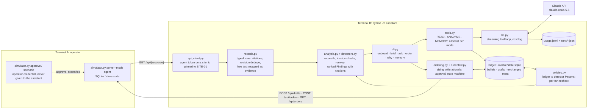

# Architecture

One Python package, one agent core, four commands (`onboard`, `brief`, `ask`, `order`) plus `why`
and `memory`, over the supplied local API. Numbers come from code; the model narrates and converses.
A SQLite ledger holds what the manager decided and what the detectors observed, with rules in code
for which of those a new data revision may change.

## Data flow

Every command fetches all twelve resources at one `dataset_revision`, parses them into typed rows
(higher `source_revision` replaces, equal-but-different is a conflict) and runs the detectors. Each
Finding carries citations (file, restaurant, row or note id, revision), an uncertainty list, a next
step and its numbers. `policies.py` turns active beliefs into detector parameters before the run and
afterwards re-records observations, clears stale ones, rechecks evidence assertions and reports what
moved. In live mode the deterministic text goes to the model as data with READ and ANALYSIS tools;
the output is narration, and the retained/rechecked footer is always appended from code.

## Storage

`.marble/state.sqlite` (the assistant's own, gitignored): `beliefs` (kind, subject, value, source,
status, recheck rule, revision, supersedes/conflicts links), `drafts` (draft id, exact order JSON,
state, order id, last error), `exchanges` (each `ask` question with everything up to its answer),
`meta` (onboarding stamp, last revision, last headline, note refs seen). `usage.jsonl` records
tokens and dollars per model call; `runs/` keeps each model conversation. The simulator's `.state/`
database and the CSVs are never opened by the assistant (a test asserts it).

## External calls

The simulator over HTTP with `Authorization: Bearer demo-agent-site-01`, and the Claude API through
the official SDK with streaming, strict tool schemas and `output_config.effort`. Nothing else. No
real vendor is contacted; the only write endpoints used are `POST /api/drafts` and `POST /api/orders`.

## Main decisions

- **Code computes, the model narrates.** Detectors, reconciliation, sizing and ranking are
  deterministic and pinned by tests on the fixture's numbers. `--dry` prints the same brief without
  the model, which is also the fallback when the key or network is missing.
- **Beliefs have kinds and authority.** `policy` and `preference` are human-only and never rechecked
  against data. `observation` is detector-only and rechecked every run. `assertion` is a fact from a
  person or a record: a newer statement of equal or higher authority supersedes, a lower one (a
  corrected invoice against the manager's word) marks it conflicted and never overwrites. Nothing is
  deleted; `why <subject>` walks the chain.
- **Onboarding asks for rules, not facts.** The six questions come from finding classes present now,
  the options and their ledger effects are fixed in code, and "unknown, keep checking" records the
  default rule while leaving the fact at evidence level. That is what keeps the brief correct when
  `dataset_revision` flips to 2: the phantom receipt clears, two invoice records are superseded, the
  ten human beliefs are untouched, and the brief opens with exactly that.
- **The order is a state machine under the operator's keyboard.** The model has no draft, submit or
  approval tools in any mode. A lost response is verified by `client_reference`, retried once for the
  same draft, else kept `unknown` and blocks new drafts for that vendor until a restart settles it.
  "Accepted" is only said after a lookup agrees, and means recorded, not delivered.
- **Free text is evidence.** Notes and supplier documents reach the model only inside escaped
  `<evidence>` tags; instruction-like text is flagged as a finding. SUP-V1-01's three instructions each
  have a test showing there is no code path to obey them.
- **Scope is structural.** `site_id` is pinned in the client, no tool accepts it, and the fixture
  returns 403 for anything else.

## Retained versus rechecked, in one table

| Kind | Written by | Rechecked | On a new revision |
|---|---|---|---|
| policy, preference | a person (onboarding, `ask`, `set`) | never | unchanged; named in "Applied" |
| assertion from a person | a person | never | a disagreeing record flags it "Needs you" |
| assertion from a record or note | evidence | on revision change | superseded with a visible chain |
| observation | detectors | every run | re-recorded, changed, or cleared with the reason |

## Limits

- No live model call has been made yet (no key during the build); narration, order explanation and
  model-worded onboarding are tested with a fake API only. Measured cost so far: $0.
- Sizing uses a seven-day theoretical average for every day in the window plus the brunch uplift on
  weekend days; no per-weekday demand model, no allowance for the item with no recipe.
- The order cutoff rule is the one note N09 states ("noon the day before"), applied to every vendor.
- Assertions are rechecked only for invoice status and delivery date; a new route note becomes a
  finding, not an automatic assertion update.
- Detectors and question builders target this dataset's finding classes; other data needs new
  builders and pins. The scale dataset was not loaded. One restaurant, one process, SQLite.

## Where a change goes

A threshold or rule: one ledger row via `ask`, no code. A new check: one function in `detectors.py`
with a pinned test. A new onboarding question: one builder in `onboarding.py`. A new tool: one
decorated function in `tools.py`, visible only in the modes whose set it joins.
