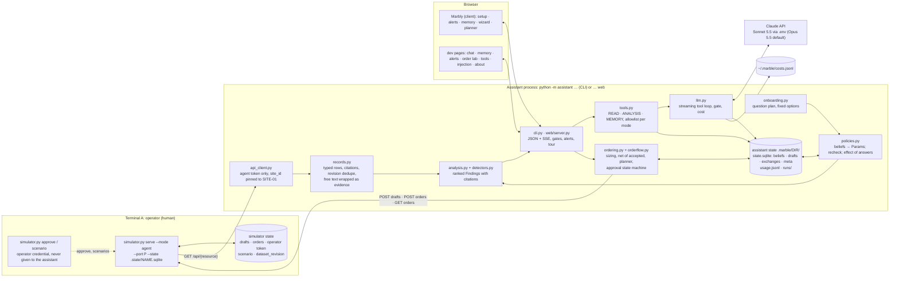

# Architecture

One Python package, one agent core, four modes (`onboard`, `brief`, `ask`, `order`) that differ only by
prompt and tool allowlist, reachable from the CLI, from a stdlib web server, and from "Marbly", the
client page the web server serves by default. Numbers come from code; the model narrates, words and
converses. A SQLite ledger holds what the manager decided and what the detectors observed, with rules
in code for which of those a new data revision may change.

## Data flow

Every run fetches all twelve resources at one `dataset_revision`, parses them into typed rows (higher
`source_revision` replaces, equal-but-different is a conflict) and runs the detectors. Each Finding
carries citations (file, restaurant, row or note id, revision), uncertainties, a next step and its
numbers. `policies.py` turns active beliefs into detector parameters before the run and afterwards
re-records observations, rechecks evidence assertions and reports what moved. In live mode the
deterministic text goes to the model as data with READ and ANALYSIS tools; the output is narration; the "orders to cover" table (the planner's view, one suggested draft per vendor) and the
retained/rechecked footer always come from code. The web server exposes the same functions as
JSON, streams model turns over SSE, and holds a memory write until the browser answers the approval
card. Marbly's four setup steps stay pinned until each is true in the ledger.

## Two databases

The **simulator's** SQLite (`.state/NAME.sqlite`, the operator's `--state`) holds the supplier's
drafts and orders, the operator token, the scenario flag and the dataset revision. The **assistant's**
directory (`.marble/DIR/`) holds `state.sqlite` with `beliefs` (kind, subject, value, source, status,
recheck rule, revision, supersedes/conflicts links), `drafts` (the order as drafted, state, order id,
note), `exchanges` and `meta` (onboarding stamp and answers, setup progress, last run), plus
`usage.jsonl` and `runs/`. Neither process opens the other's file (a test asserts it); the only link is
the draft id, used to verify an order after a lost response. Starting over: "Ask me the questions
again" clears only the onboarding meta; "Forget everything" (`POST /api/reset`) wipes `.marble/DIR` and
Marbly re-onboards on the next reload. The supplier's reset is the operator's move: `demo/operator_helper.py
serve` runs the simulator and, on `POST /reset` from the browser (the same button, when
`MARBLE_OPERATOR_URL` is set) or from the shell, stops it, deletes its file and starts it again. The
assistant process never calls it. The About page prints the commands with the running server's paths.

## External calls

The simulator over HTTP with `Authorization: Bearer demo-agent-site-01`, and the Claude API through
the official SDK with streaming, strict tool schemas, prompt caching and `output_config.effort`;
`.env` selects the model. Nothing else. No real vendor is contacted; the only write endpoints used are
`POST /api/drafts` and `POST /api/orders`.

## Main decisions

- **Code computes, the model narrates.** Detectors, reconciliation, sizing, ranking and the netting of
  accepted orders are deterministic and pinned by tests; `--dry` runs every flow without the model.
- **Beliefs have kinds and authority.** `policy` and `preference` are human-only and never rechecked
  against data. `observation` is detector-only and rechecked every run. `assertion` is a fact from a
  person or a record: a newer statement of equal or higher authority supersedes, a lower one (a
  corrected invoice against the manager's word) marks it conflicted and never overwrites. Nothing is
  deleted; `why <subject>` walks the chain. The model's only write is `record_belief`, in `ask` mode,
  behind a human approval gate.
- **Onboarding asks for rules, not facts.** The six questions come from finding classes present now,
  the options and their ledger effects are fixed in code, the model only words the lead-in, and
  "unknown, keep checking" records the default rule while leaving the fact at evidence level. That is
  what keeps the brief correct when `dataset_revision` flips to 2: the phantom receipt clears, two
  invoice records are superseded, the ten human beliefs are untouched, and the brief opens with that.
- **The order is a state machine under the operator's keyboard.** The model has no draft, submit or
  approval tools in any mode; a worded revision only proposes lines that code validates. A lost
  response is verified by `client_reference`, retried once for the same draft, else kept `unknown`.
  "Accepted" is only said after a lookup agrees, and means recorded, not delivered. The wizard reads
  the ledger: every draft with its status, resume one awaiting approval, propose only what is left.
- **Free text is evidence.** Notes and supplier documents reach the model only inside escaped
  `<evidence>` tags; instruction-like text is flagged as a finding. SUP-V1-01's three instructions
  each have a test showing there is no code path to obey them.
- **Scope is structural.** `site_id` is pinned in the client, no tool accepts it, and the fixture
  returns 403 for anything else.

## Retained versus rechecked, in one table

| Kind | Written by | Rechecked | On a new revision |
|---|---|---|---|
| policy, preference | a person (onboarding, `ask`, Memory page) | never | unchanged; named in "Applied" |
| assertion from a person | a person | never | a disagreeing record flags it "Needs you" |
| assertion from a record or note | evidence | on revision change | superseded with a visible chain |
| observation | detectors | every run | re-recorded, changed, or cleared with the reason |

## Evaluation

Eight deterministic evaluators (numbers grounded in tool output, citations resolvable, allowlist
respected, memory only from a person, injection quoted not followed, brief shape, cost bound) run over
recorded runs and fixtures; an agentic suite drives nine scenarios through the real server with a
persona and a calibrated Sonnet judge. `VERIFICATION.md` records what each live run found and fixed.

## Limits

- Live model runs are recorded with their cost in `VERIFICATION.md` (about $2.8 over 122 calls by
  Nov 4); two judge criteria stayed open after the last iteration.
- Sizing uses a seven-day theoretical average for every day in the window plus the brunch uplift on
  weekend days; no per-weekday demand model, no allowance for the item with no recipe. The cutoff
  rule is the one note N09 states ("noon the day before"), applied to every vendor.
- Assertions are rechecked only for invoice status and delivery date; a new route note becomes a
  finding, not an automatic assertion update. Accepted orders are netted per SKU, not treated as
  inbound supply in the runway.
- Detectors and question builders target this dataset's finding classes; other data needs new
  builders and pins. One restaurant, one process, SQLite, no authentication on the web server.

## Where a change goes

A threshold or rule: one ledger row via `ask` or the Memory page, no code. A new check: one function in
`detectors.py` with a pinned test. A new onboarding question: one builder in `onboarding.py`. A new
tool: one decorated function in `tools.py`, visible only in the modes whose set it joins. A new client
step: one entry in the server's tour and one message in `client.js`.
