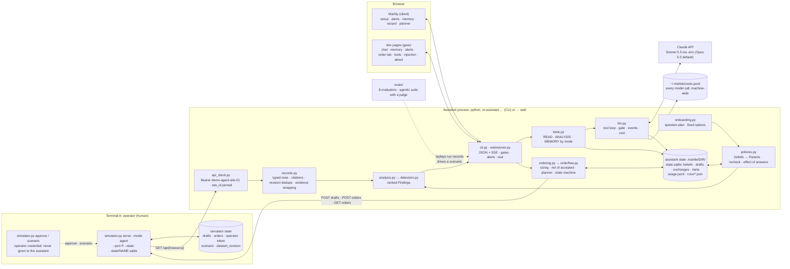

# System architecture

Two databases, two credentials. The simulator's SQLite (left) holds the supplier's view and the
operator token; the assistant's SQLite (right) holds what the manager decided, what the detectors
observed, and the drafts as the assistant saw them. The dashed line is the credential boundary:
the operator's helper talks to the fixture; the assistant only ever holds the agent token, and
nothing in its process opens `.state/` or the CSVs. The browser talks only to the assistant.
