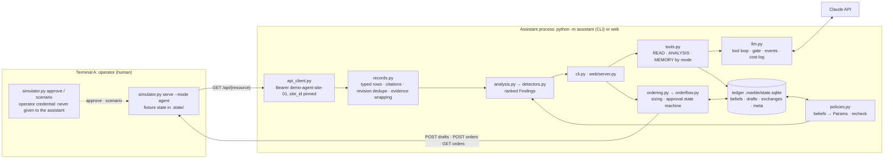

# System architecture

The credential boundary is the dashed line: the operator's helper talks to the fixture; the
assistant only ever holds the agent token. Nothing in the assistant process reads `.state/` or the CSVs.
