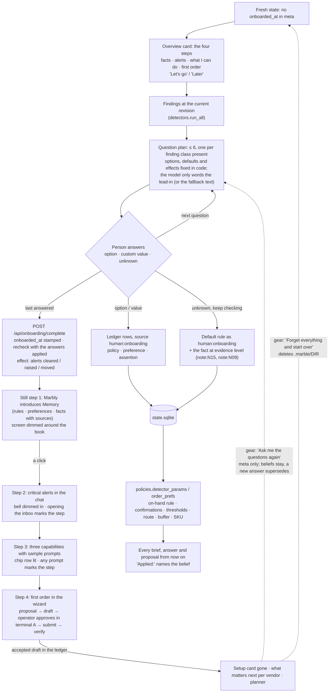

# Onboarding flow (Marbly)

The four steps are pinned to the top until each is true in the ledger: facts when `onboarded_at` is
stamped, alerts when the inbox was opened, capabilities when a prompt was sent, the order when a draft
is `accepted`. A human
answer is never rechecked against data; "unknown" leaves the fact where a later record can supersede
it. In dry mode the same flow runs with the fallback lead-ins and no model.
