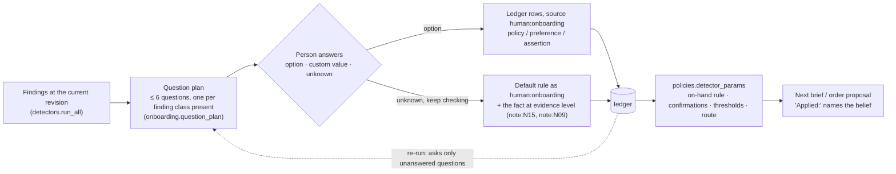

# Onboarding information flow

Options, defaults and what each answer records are fixed in code; the model may only word the
lead-in. A human answer is never rechecked against data; an "unknown" leaves the fact where a later
record can supersede it.
