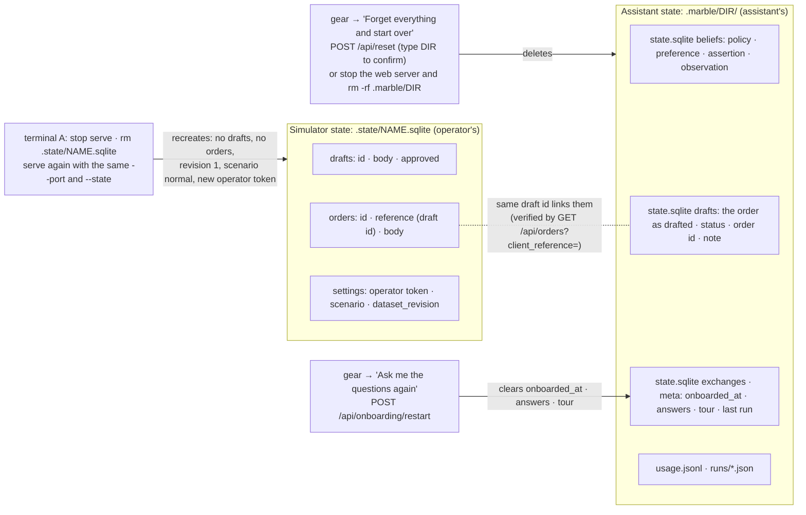

# Two databases, and how to start over

The two files never open each other; the only link is the draft id, which the assistant uses to
verify an order after a lost response. Re-asking the questions keeps every belief (a changed answer
supersedes the old one with the chain kept). Forgetting everything wipes the assistant's directory and
Marbly opens with the four-step setup on the next reload, but the supplier still holds yesterday's
drafts and orders, so the wizard's list and the planner start empty while `GET /api/orders` does not.
For a fresh run of the whole demo wipe both: reset the assistant from the gear, then stop the
simulator, delete its file and start it again; the About page prints the exact commands for this
server's paths.
